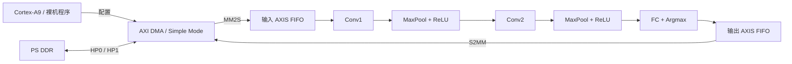

# CNN SoC：基于 Zynq-7020 的手写数字识别加速器

使用 Verilog 实现定点 CNN 推理核心，并通过 AXI DMA 与 Zynq Processing System 集成，实现从 DDR 图像输入到分类结果回传的 MNIST 手写数字识别流程。

项目包含 CNN RTL、逐层与端到端 Testbench、Python bit-exact 参考模型、固定网络参数、测试向量和 Vivado SoC 工程，适合学习定点推理、流式硬件设计、存储架构优化和 PS/PL 协同。

> **版本说明：** 本文以已提交的存储优化版本 `8a185a5` 为代码依据，其中 Conv2 使用 B1 流式窗口缓存。下文的板上性能与资源数据来自 2026-09-03 的历史基线报告，不代表 B1 或后续 B3/B4 实验的重新实测结果。

## 项目特点

- 两层卷积、两层 MaxPool + ReLU 和一层全连接分类，输出数字 `0～9`。
- 8 bit 输入像素、INT8 权重、12 bit 中间激活，配套逐位一致的 Python 参考模型。
- Conv1 行缓存、Conv2 流式窗口缓存、FC 平衡加法树及流水化乘加。
- AXI-Stream 输入与输出握手，支持输出反压期间的数据保持。
- PS 通过 AXI DMA Simple Mode 访问 DDR，PL 使用 100 MHz 时钟。
- 保留分层仿真、批量回归、综合实现报告和阶段总结，便于追溯结果。

## 系统架构



历史 SoC 配置采用输入 `8192 × 8 bit` FIFO、输出 `64 × 8 bit` FIFO、DMA 控制地址 `0x40400000`。MM2S 和 S2MM 分别连接 PS 的 HP0 和 HP1 端口；实际地址与连接以所用 Block Design 和导出 XSA 为准。

### 网络结构

| 阶段 | 运算 | 输出形状 | 数据格式 |
| --- | --- | --- | --- |
| 输入 | 28 × 28 灰度图，按行发送 | 28 × 28 × 1 | UINT8 |
| Conv1 | 3 × 3，有效卷积，4 个输出通道 | 26 × 26 × 4 | INT12 |
| Pool1 | 2 × 2 最大池化 + ReLU | 13 × 13 × 4 | 非负 INT12 |
| Conv2 | 3 × 3，有效卷积，8 个输出通道 | 11 × 11 × 8 | INT12 |
| Pool2 | 2 × 2 最大池化 + ReLU | 5 × 5 × 8 | 非负 INT12 |
| FC | 200 个输入，10 个类别得分 | 10 | INT12 |
| Argmax | 选择最大得分类别 | 1 字节 | 0～9 |

Pool2 对 11 × 11 输入保留完整的 2 × 2 窗口，因此输出为 5 × 5。跨层数据打包时，通道 0 位于最低位；Python 参考模型采用相同顺序。

### 定点参数与存储

参数保存在 `doc/params/`，由 RTL 中的 `$readmemh` 读取，并在综合时固化进硬件。当前设计不提供运行时权重加载接口，也未包含训练流程。

参考模型复现 RTL 的移位、截断、饱和与有符号运算。Conv2 偏置应按 `signed8` 解释；`zero_extend16` 是用于对照旧偏置行为的模式。更换参数或运算规则后，应重新生成参考向量并执行回归。

B1 的 `conv2_buf.v` 使用两行 `13 × 48 bit` 延迟存储、横向移位寄存器和 8 项窗口 FIFO，替代早期完整特征图双 Bank 的多地址并行读取结构。旧报告中的 3,456 LUTRAM 是早期 Conv2 缓存结果，不能直接作为 B1 的资源占用。

## 仓库结构

```text
cnn_soc/
├── rtl/                          # CNN 可综合 Verilog
│   ├── axix_cnn_mnist.v           # 顶层模块名为 axis_cnn_mnist
│   ├── conv1_{buf,calc,layer}.v
│   ├── conv2_{buf,calc,layer}.v
│   ├── maxpool_relu.v
│   └── fully_connected.v
├── sim/                          # 逐层、端到端、批量与反压仿真
├── doc/
│   ├── params/                   # 权重、偏置和参考输出 .mem
│   ├── test_data/                # 单图与 1000 图十六进制像素数据
│   ├── reports/                  # 历史综合、实现、资源及时序报告
│   ├── stage/1/                  # 板上部署报告与存储架构审计
│   └── design_1.tcl              # 历史 SoC Block Design 创建脚本
└── prj/
    ├── python/                   # 单图与批量 bit-exact 模型
    └── vivado/cnn/               # Vivado 工程、BD、约束及导入源文件
```

`axix_cnn_mnist.v` 的文件名保留了原有拼写，实例化和设置顶层时使用模块名 **`axis_cnn_mnist`**。部分 RTL 在 Vivado 工程的 `imports/` 下还有副本，复现前应检查 Sources 中实际引用的文件，避免重复添加同名模块。

## 开发环境

| 项目 | 配置 |
| --- | --- |
| 历史验证板卡 | 正点原子领航者 ZYNQ-7020 V1 |
| FPGA 器件 | XC7Z020-2CLG400，工程 part 为 `xc7z020clg400-2` |
| FPGA / 裸机工具链 | Vivado 2020.2 / Vitis 2020.2 |
| PL 时钟 | 100 MHz |
| 串口 | UART0，115200 bit/s |
| 软件参考模型 | Python 3.10+，仅使用标准库 |
| 可选 RTL 仿真 | Icarus Verilog，需提供 `iverilog` 与 `vvp` |

## 快速开始

以下命令在 Windows PowerShell 中执行。Python 与 Icarus Verilog 需已加入 `PATH`；也可以使用可执行文件的完整路径。

```powershell
git clone https://github.com/duyu07057-lang/cnn_soc.git
Set-Location cnn_soc
```

### 1. 运行单图参考模型

```powershell
python prj/python/bit_exact_ref.py `
  --input doc/test_data/9_0.txt `
  --params-dir doc/params `
  --output-dir "$env:TEMP/cnn_soc_ref_9" `
  --prefix 9 `
  --conv2-bias-mode signed8 `
  --expect-decision 9
```

程序生成 Conv1、Pool1、Conv2、Pool2 和 FC 参考结果，以及包含输入、参数 SHA-256、张量形状和 logits 的 JSON 摘要。`--expect-decision` 不匹配时程序返回失败。

### 2. 生成 1000 图参考结果

```powershell
python prj/python/batch_bit_exact_ref.py `
  --input doc/test_data/input_1000.txt `
  --params-dir doc/params `
  --output-dir "$env:TEMP/cnn_soc_ref_1000" `
  --num-images 1000 `
  --label-mode cyclic
```

`cyclic` 表示标签按照 `0, 1, …, 9` 循环生成，只适用于当前数据排列。其他数据集应使用 `--label-mode none`，并另外提供真实标签。批量脚本的输出文件名固定带有 `1000`，即使修改 `--num-images` 也不会改变文件名。

### 3. 执行 RTL 批量冒烟仿真

下面的示例针对上述已提交版本的单图 AXI 数据包接口，验证前 10 张图的分类与全部 10 个 logits。临时目录用于让 `$readmemh` 找到参数和测试数据。

```powershell
$repo = (Get-Location).Path
$simDir = Join-Path $env:TEMP ("cnn_soc_sim_" + [guid]::NewGuid().ToString("N"))
New-Item -ItemType Directory -Path $simDir | Out-Null
Copy-Item "$repo/doc/params/*.mem" -Destination $simDir
Copy-Item "$repo/doc/test_data/input_1000.txt" -Destination $simDir
$rtlFiles = Get-ChildItem "$repo/rtl/*.v" | Select-Object -ExpandProperty FullName

Push-Location $simDir
try {
    iverilog -g2012 -DRUN_IMAGES=10 -s tb_axis_cnn_mnist_batch `
      -o cnn_batch.vvp @rtlFiles "$repo/sim/tb_axis_cnn_mnist_batch.v"
    if ($LASTEXITCODE -ne 0) { throw "RTL 编译失败" }
    vvp cnn_batch.vvp
    if ($LASTEXITCODE -ne 0) { throw "RTL 仿真失败" }
} finally {
    Pop-Location
}
```

将 `-DRUN_IMAGES=10` 改成 `-DRUN_IMAGES=1000` 可运行完整批量回归。其他入口包括 `tb_axis_cnn_mnist_e2e.v`、`tb_axis_cnn_mnist_backpressure.v`、`tb_conv2_buf_b1.v` 和 `tb_conv2_layer_b1.v`；逐层测试需按各文件开头的宏定义准备对应输入与 golden 文件。

2026-10-11 编写本文时，使用 `8a185a5` 的 RTL 在隔离目录复核：单图 Python 参考结果为 `9`；10 图 RTL 回归完成 7840 次输入握手，分类与全部 logits 均与参考模型一致，结果间隔为 1092 cycles。这是该次行为仿真的观察值，尚未复测对应版本的布局布线或板上性能。

**接口版本注意：** 本文对应版本没有 `s_axis_tlast` 输入，内部每接收 784 次有效握手计为一张图，每个分类结果都带输出 `TLAST`，且前一结果完成握手后才接收下一图。如果使用已增加 `s_axis_tlast` 的 B3 实验 RTL，必须配套连接该端口并使用 B3 Testbench；旧 Testbench 不能直接套用。B3 的数据包可包含多张完整图像，仅最后一个结果携带 `TLAST`。

## Vivado 工程与上板流程

1. 用 Vivado 2020.2 打开 `prj/vivado/cnn/cnn.xpr`，检查 Sources、IP 状态和 Block Design `cnn_system`。
2. 确认全部 RTL 文件路径有效，并检查工程实际使用的 `conv2_buf.v` 版本。若本机工程曾切换到仓库外的 B3/B4 实验目录，先将 Sources 指向需要复现的版本。
3. 确认 16 个权重和偏置 `.mem` 文件被加入设计源并用于综合。缺失参数可能造成计算通路被裁剪，此时较低资源占用不代表优化成功。
4. Validate Design，生成 IP 输出产品与 HDL Wrapper，以 `cnn_system_wrapper` 为 SoC 顶层，依次完成综合、实现和 Bitstream 生成。
5. 检查实现后的时序、DRC 和布线结果，再导出包含 Bitstream 的 XSA。
6. 在 Vitis 中使用该 XSA 创建 Cortex-A9 Standalone 平台与 AXI DMA Simple Mode 应用。
7. 每图准备 784 字节发送缓冲和 1 字节接收缓冲；发送前 Flush Cache，先启动 S2MM，再启动 MM2S，等待两路完成后 Invalidate 接收缓冲并读取结果。
8. 先执行单图验证，再执行 10 图与 1000 图回归，同时比较分类结果与 bit-exact 模型。

`doc/design_1.tcl` 对应历史系统配置，不能视为后续全部实验版本的一键重建脚本。当前 Git 提交未包含完整 Vitis 应用工程；本机 Vitis 工作区、平台和 XSA 可能被 `.gitignore` 排除，因此仅克隆仓库无法直接复现历史裸机程序，需自行创建应用并匹配硬件接口。

## 历史验证结果

以下指标来自 [Zynq 部署阶段报告](doc/stage/1/cnn_zynq7020_stage_report_2026-09-03.md)，对应 **2026-09-03、FC 与 Conv2 流水化后的 SoC 基线**。

| 指标 | 历史结果 |
| --- | --- |
| 10 图详细板上回归 | 硬件与模型 10/10 一致 |
| 1000 图板上回归 | 硬件与模型 1000/1000 一致 |
| 当前循环标签回归集正确率 | 990/1000，99.00% |
| 实现后 Setup WNS / Hold WHS | +0.153 ns / +0.028 ns |
| SoC LUT / FF | 12,013 / 6,785 |
| SoC BRAM36 / DSP48E1 | 4 / 152 |
| 核心结果间隔 | 1664 cycles，100 MHz 下为 16.640 μs |
| 1000 图平均 Active latency | 20.342 μs/image |
| 1000 图应用吞吐率 | 约 40,214 images/s |

硬件与模型一致率用于验证硬件是否正确执行定点模型；标签正确率用于评估模型预测。这里的 **99.00% 属于当前循环标签回归集，不是完整 MNIST 官方 10,000 图测试集准确率**。

Active latency 包含 DMA 配置、传输、推理和轮询；应用吞吐率还计入图像复制、Cache 维护与统计开销。报告注明当时软件构建为 Debug / `-O0`，正式性能对比应记录编译选项并重新测量。

## 进一步阅读与复现边界

- [CNN 加速器 Zynq-7020 端侧部署阶段报告](doc/stage/1/cnn_zynq7020_stage_report_2026-09-03.md)：系统集成、时序优化、历史板测与性能定义。
- [存储架构基线与优化审计](doc/stage/1/cnn_storage_architecture_baseline_v1_2026-09-03.md)：各层存储容量、多读端口带来的物理开销和优化方向。
- `doc/reports/`：历史综合、实现、资源、DRC 和时序原始报告；比较前应核对版本与报告阶段。

后续可继续评估 Conv2 存储映射、DMA 批量传输、跨帧重叠、Release 软件开销及板级功耗。改变 RTL、参数、BD 或工具设置后，需要重新验证功能与实现结果；历史通过记录不自动覆盖新版本。
